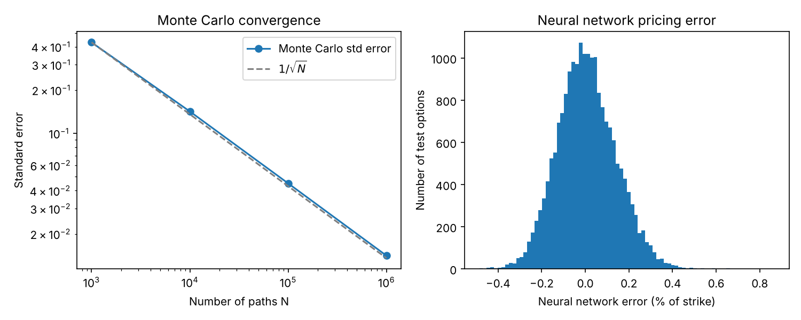

# Equity Derivatives & ML: Option Pricing with Black-Scholes, Monte Carlo and Neural Networks

Can a neural network reproduce the price of an option faster than Monte Carlo, and with what error?
The test is run on a European call, where Black-Scholes gives the exact price.



## Method

- **Black-Scholes**: closed-form reference price.
- **Monte Carlo**: geometric Brownian motion, convergence in `1/sqrt(N)` up to 1,000,000 paths.
- **Neural network** (scikit-learn `MLPRegressor`, 2 x 64 neurons, ReLU): trained on 100,000
  simulated options to learn `price / K` as a function of `(S/K, T, sigma, r)`.

## Results

Reference option (S = K = 100, T = 1y, sigma = 20%, r = 3%): Black-Scholes price 9.4134.

| Paths | Monte Carlo price | Standard error |
|---|---|---|
| 1,000 | 8.8811 | 0.4293 |
| 10,000 | 9.3590 | 0.1421 |
| 100,000 | 9.3936 | 0.0449 |
| 1,000,000 | 9.4200 | 0.0141 |

Neural network on 20,000 unseen test options:

| Metric | Value |
|---|---|
| R^2 | 0.99992 |
| Mean absolute error | 0.106% of strike |
| 99th percentile of the absolute error | 0.351% of strike |
| Mean relative error (options worth more than 1% of strike) | 1.31% |

Time to price 20,000 options (2-core machine, indicative): Black-Scholes 3 ms, neural network
26 ms, Monte Carlo with 100,000 paths per option 57 s. The network is about 2,000 times faster
than Monte Carlo.

## Limitations

- For a European call the network is useless in practice (Black-Scholes is exact and faster):
  this is a proof of concept for products without a closed form.
- Valid only inside the training ranges; no error bound and no no-arbitrage guarantee.

## Run

```bash
pip install numpy scipy scikit-learn matplotlib
python ml_option_pricing.py
```

A detailed write-up is in `3_ml_option_pricing.pdf`.
